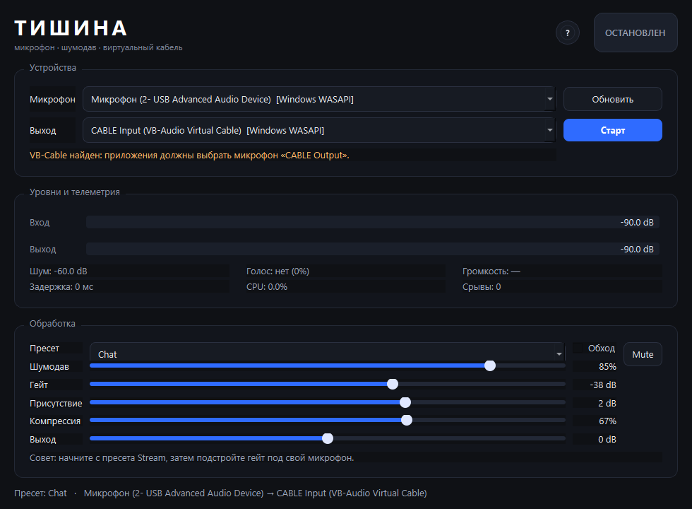

# Тишина Lite

Личный микрофонный процессор для Windows: шумодав, гейт, эквалайзер, компрессор и лимитер. Приложение берёт звук с микрофона, обрабатывает его и отдаёт в виртуальный кабель, который выбирают OBS, Discord, Zoom, браузер и игры.



## Скачать

**[Последний релиз](https://github.com/ReQCreate/-/releases/latest)** — скачайте `TishinaSetup.exe`.

Установщик ставит программу в профиль пользователя, без прав администратора. VB-Cable в комплект не входит: он устанавливается отдельно с [официального сайта](https://vb-audio.com/Cable/).

## Документация

- [Быстрый старт](docs/БЫСТРЫЙ_СТАРТ.md) — установка, VB-Cable, OBS/Discord за пять минут.
- [Руководство пользователя](docs/РУКОВОДСТВО_ПОЛЬЗОВАТЕЛЯ.md) — полное описание, настройка, диагностика, ограничения.
- [FAQ](docs/FAQ.md) — короткие ответы на частые вопросы.
- [Сторонние компоненты и лицензии](THIRD_PARTY_NOTICES.md).

## Что уже есть

- RNNoise-шумодав с регулируемым dry/wet.
- Шумовой гейт с VAD от RNNoise.
- 5-полосный эквалайзер: HPF, low shelf, mid, presence, high shelf.
- Компрессор с мягким коленом и make-up.
- Лимитер с lookahead.
- Пресеты `Stream`, `Chat`, `Podcast`, `Raw`.
- Встроенная инструкция по установке VB-Cable и настройке OBS/Discord — кнопка `?` в правом верхнем углу.
- Индикаторы входа/выхода, шумового пола, VAD, громкости, задержки, CPU и срывов.
- Обход обработки, Mute, трей и горячие клавиши в окне приложения.
- Установщик `TishinaSetup.exe` без прав администратора.

## Цепочка обработки

```text
Микрофон
  → HPF 80 Гц
  → де-хам 50 Гц (встроен в HPF/эквалайзер)
  → RNNoise dry/wet
  → гейт + VAD
  → 5-полосный EQ
  → компрессор
  → лимитер
  → выходной gain
  → CABLE Input
```

Формат: 48 кГц, моно, `float32`, кадр 480 сэмплов (10 мс).

## Маршрут звука

```text
Микрофон → Тишина → CABLE Input → CABLE Output → OBS / Discord / Zoom
```

- В «Тишине» выход — `CABLE Input`.
- В OBS/Discord/Zoom микрофон — `CABLE Output`.

Не наоборот.

## Требования

- Windows 10/11 x64.
- Микрофон, желательно с поддержкой 48 кГц.
- [VB-Cable](https://vb-audio.com/Cable/) — устанавливается отдельно, в установщик не входит.
- Для сборки из исходников: Python 3.11 или 3.12.

## Быстрый старт

1. Установите `TishinaSetup.exe` из [релизов](https://github.com/ReQCreate/-/releases/latest).
2. Установите VB-Cable и перезагрузите компьютер, если потребуется.
3. Запустите «Тишину».
4. Выберите микрофон и выход `CABLE Input`, пресет `Stream`, нажмите «Старт».
5. В OBS/Discord выберите микрофон `CABLE Output`.

Подробно: [быстрый старт](docs/БЫСТРЫЙ_СТАРТ.md).

## Ограничения MVP

- Только Windows и только моно.
- Нет автоматической калибровки помещения.
- Нет смены голоса.
- Нет собственного драйвера: используется VB-Cable.
- Нет выделения конкретного говорящего: программа снижает шум, но не гарантирует, что в микрофон не попадут другие голоса.
- Задержка зависит от драйвера и очередей; ориентир — десятки миллисекунд.

Если в комнате громкая музыка, телевизор или разговоры рядом, лучший практический результат даёт близкий микрофон/гарнитура и push-to-talk, а не только программная обработка.

## Установка

Скачайте `TishinaSetup.exe` из [GitHub Releases](https://github.com/ReQCreate/-/releases/latest).

Установщик не подписан кодом, поэтому Windows SmartScreen может показать предупреждение. Для личного использования это ожидаемо. Скачивайте файл только из официального релиза.

## Сборка `.exe`

```powershell
powershell -ExecutionPolicy Bypass -File .\build.ps1 -Clean
```

Результат:

```text
dist\Tishina\Tishina.exe
```

Сборка `--onedir`: запускается быстрее, чем `--onefile`, и проще диагностируется. Папку `dist\Tishina` нужно распространять целиком.

## Установщик

```powershell
powershell -ExecutionPolicy Bypass -File .\build_setup.ps1
```

Результат:

```text
dist_installer\TishinaSetup.exe
```

Для сборки нужен Inno Setup 6:

```powershell
winget install JRSoftware.InnoSetup
```

Установщик ставит приложение в `%LOCALAPPDATA%\Programs\Tishina` без прав администратора, создаёт ярлыки в меню «Пуск» и на рабочем столе, добавляет удаление через «Параметры → Приложения». VB-Cable в установщик не входит: ссылка и инструкция доступны внутри приложения по кнопке `?`.

## Структура проекта

```text
tishina/
  app.py                     точка входа
  run.ps1                    запуск для разработки
  build.ps1                  сборка exe
  build_setup.ps1            сборка установщика
  setup_rnnoise.ps1          загрузка rnnoise.dll
  Tishina.spec               конфигурация PyInstaller
  installer/
    Tishina.iss              сценарий Inno Setup
    info_before.txt          памятка перед установкой
  docs/                      руководство, быстрый старт, FAQ
  licenses/                  полные тексты лицензий
  tishina/
    config.py                пути и константы
    presets.py               загрузка пресетов
    audio/
      engine.py              sounddevice, очереди, потоки
      chain.py               порядок DSP-модулей
      analysis.py            метры, шумовой пол, LUFS
      modules/               RNNoise, гейт, EQ, компрессор, лимитер, gain
    presets/                 встроенные JSON-пресеты
    ui/                      PySide6-интерфейс, guide.py — встроенная инструкция
    vendor/rnnoise.dll       бинарник RNNoise
  tools/
    list_devices.py          список аудиоустройств
    process_wav.py           офлайн-обработка WAV
    make_test_wav.py         генерация тестового сигнала
```

## Офлайн-проверка без микрофона

```powershell
python tools/make_test_wav.py test_input.wav
python tools/process_wav.py test_input.wav test_output.wav --preset Stream
```

Так можно проверить DSP, не устанавливая VB-Cable.

## Диагностика

Коротко:

- **Нет `CABLE Input`** — проверьте установку VB-Cable, нажмите «Обновить», перезагрузите компьютер.
- **Не двигается «Вход»** — проверьте микрофон, доступ Windows к микрофону и закройте программы, которые заняли устройство.
- **В OBS/Discord тишина** — проверьте маршрут: выход в «Тишине» — `CABLE Input`, микрофон в приложении — `CABLE Output`.
- **Эхо** — уберите прямой микрофон из OBS/Discord и отключите встроенные шумодавы приложения.
- **Гейт режет слова** — опустите порог гейта до `-48…-50 dB`; если пролезает шум — поднимите до `-36…-38 dB`.

Полный список: [руководство пользователя](docs/РУКОВОДСТВО_ПОЛЬЗОВАТЕЛЯ.md#13-диагностика).

## Лицензия

Код «Тишины» — MIT. См. [LICENSE](LICENSE).

RNNoise, PySide6/Qt и другие зависимости распространяются по своим лицензиям. Полные тексты: [THIRD_PARTY_NOTICES.md](THIRD_PARTY_NOTICES.md) и [licenses/](licenses/).

VB-Cable не входит в поставку. Официальный сайт: <https://vb-audio.com/Cable/>.

## Поддержка

Проблемы и предложения: [GitHub Issues](https://github.com/ReQCreate/-/issues).
